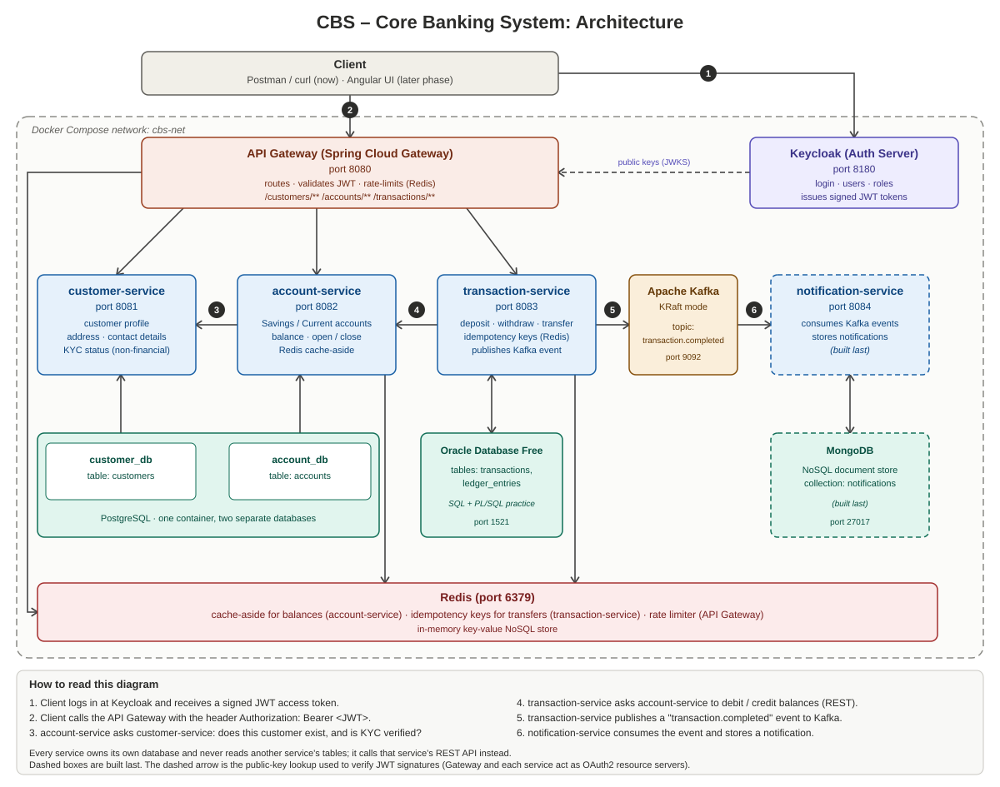

# CBS – Core Banking System (Learning Project)

A simplified core banking backend built with **Java, Spring Boot and microservices**. Customers hold accounts, and money moves between accounts as transactions. The project is built to learn and to explain: every piece should be something I can describe, draw and defend in an interview.

> **Scope note:** this is a simplified model of core banking, not a production bank. Real systems add end-of-day processing, interest accrual, general-ledger postings, regulatory reporting and much more. See [docs/FUNCTIONAL_SPEC.md](docs/FUNCTIONAL_SPEC.md) for exactly what is and is not included.

## Architecture



**In one paragraph:** a client logs in at **Keycloak** and gets a **JWT**. It sends every request to the **API Gateway**, which checks the token, applies a **Redis**-backed rate limit and routes the call to the right service. **customer-service** owns customer profiles and KYC status. **account-service** owns accounts and balances and asks customer-service whether a customer is KYC-verified before opening an account. **transaction-service** performs deposits, withdrawals and transfers by calling account-service, protects against duplicate requests with Redis idempotency keys, records history in **Oracle**, and publishes a `transaction.completed` event to **Kafka**. **notification-service** consumes that event and stores a notification in **MongoDB**. Everything runs in **Docker Compose**.

## Services and ports

| Component | Port | Owns | Storage |
|---|---|---|---|
| api-gateway | 8080 | routing, JWT check, rate limiting | Redis |
| customer-service | 8081 | customers, KYC status | PostgreSQL (`customer_db`) |
| account-service | 8082 | accounts, balances | PostgreSQL (`account_db`) + Redis cache |
| transaction-service | 8083 | transactions, ledger entries | Oracle Free + Redis idempotency keys |
| notification-service | 8084 | notifications (built last) | MongoDB |
| Keycloak | 8180 | users, roles, tokens | its own internal store |
| Kafka (KRaft) | 9092 | event topic `transaction.completed` | – |
| Redis | 6379 | cache, idempotency, rate limit | – |

## Technology choices (and why)

| Technology | Why it is here |
|---|---|
| Java 17 + Spring Boot | Standard backend stack for banking and enterprise systems |
| Maven | Build and dependency management |
| Spring Web, Validation | REST controllers, request validation |
| Spring Data JPA / Hibernate | Object-relational mapping for PostgreSQL and Oracle |
| Spring Security + OAuth 2.0 + JWT | Stateless authentication and role-based authorization |
| Keycloak | A real OAuth 2.0 / OpenID Connect server, so we don't hand-write one |
| Spring Cloud Gateway | Single entry point, routing, rate limiting |
| Redis | Cache-aside, idempotency keys, rate limiter state |
| Kafka | Asynchronous events between services (producer, topic, consumer group) |
| PostgreSQL | Relational store for customer and account data |
| Oracle SQL / PL/SQL | Ledger and transaction store; also the SQL practice track |
| MongoDB | A document store for notifications, as the NoSQL example |
| Docker, Docker Compose | Run the whole system with one command |
| JUnit, Mockito | Unit tests for service classes |
| Git, GitHub | Version control and a public portfolio |

> **Spring Boot version:** I use the latest **3.5.x** because most tutorials, company codebases and interview questions still match 3.x. As of mid-2026 Spring Boot 4.x is out and 3.5's free open-source support has ended, which does not matter for a local learning project. If start.spring.io no longer offers 3.5.x, use 4.0.x; the concepts and annotations are the same.

## Repository layout

```
cbs-banking/
├── README.md
├── .gitignore
├── docker-compose.yml          # added when Docker is ready
├── docs/
│   ├── architecture.svg
│   ├── FUNCTIONAL_SPEC.md
│   └── learning-notes/         # one short note per day: what I built and why
├── api-gateway/
├── customer-service/
├── account-service/
├── transaction-service/
└── notification-service/
```

One Git repository holds all services (a "monorepo"). It keeps things simple while learning, and one `docker compose up` can build everything.

## Build plan

| Day | Focus | Done |
|---|---|---|
| 1 | Git + GitHub, project setup, Spring Boot basics, **customer-service** (layers, DI, validation, exception handling, JPA + PostgreSQL in Docker) | [ ] |
| 2 | **account-service**: OOP design (Savings/Current), JPA relationships, transactions, REST call to customer-service, Redis cache-aside | [ ] |
| 3 | **transaction-service** on Oracle: deposit, withdraw, transfer, `@Transactional`, idempotency, failure handling, SQL/PL/SQL practice | [ ] |
| 4 | **Security**: Keycloak, JWT, OAuth 2.0, roles, ownership checks | [ ] |
| 5 | **API Gateway**, rate limiting, **Kafka** producer/consumer, notification-service + MongoDB | [ ] |
| 6 | **Docker**: Dockerfiles, Compose for the whole stack, tests, end-to-end run | [ ] |
| 7 | Project walkthrough practice, mock interview, polish | [ ] |

Angular comes after the backend is complete.

## Running locally

Prerequisites: JDK 17+, Maven, Docker Desktop, Git.

```bash
git clone <your-repo-url>
cd cbs-banking
docker compose up -d        # available from Day 1 (databases) and grows each day
```

The exact commands per service are added to each service folder as it is built.

## Git workflow I follow

- `main` always works. New work happens on a branch such as `feature/customer-service`.
- Small, frequent commits with clear messages, for example `feat(customer): add create customer endpoint` or `fix(account): handle missing customer`.
- Prefixes: `feat`, `fix`, `docs`, `test`, `refactor`, `chore`.
- Never commit passwords, tokens or `.env` files.

### First-time setup (once)

```bash
git config --global user.name  "Your Name"
git config --global user.email "your-github-email@example.com"
```

### Create the repo and push

```bash
cd cbs-banking
git init -b main
git add .
git commit -m "docs: add architecture, functional spec and README"
```

Then on github.com click **New repository**, name it `cbs-banking`, leave it empty (no README, no .gitignore), and run:

```bash
git remote add origin https://github.com/<your-username>/cbs-banking.git
git push -u origin main
```

GitHub does not accept account passwords for pushes. When Git asks you to sign in, use the browser sign-in window it opens (Git Credential Manager on Windows), or install GitHub CLI and run `gh auth login`.

## Interview-readiness checklist

For every feature I can answer: **what it does, why it exists, how it works, what could go wrong, and what the alternative is.** Daily notes live in `docs/learning-notes/`.
