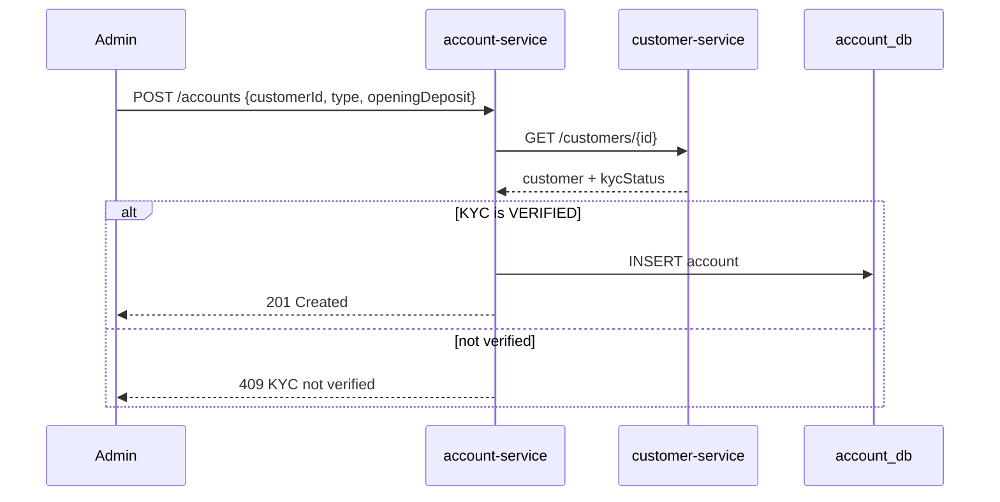
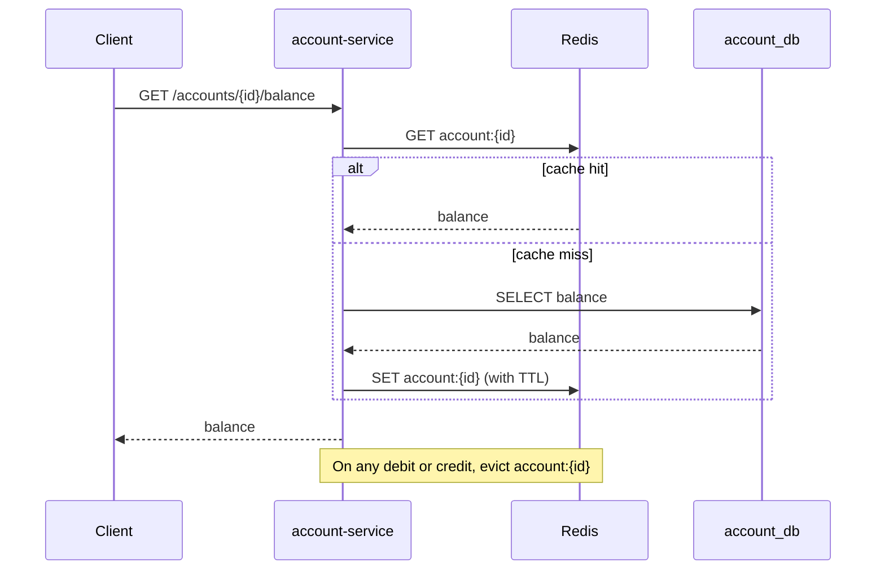
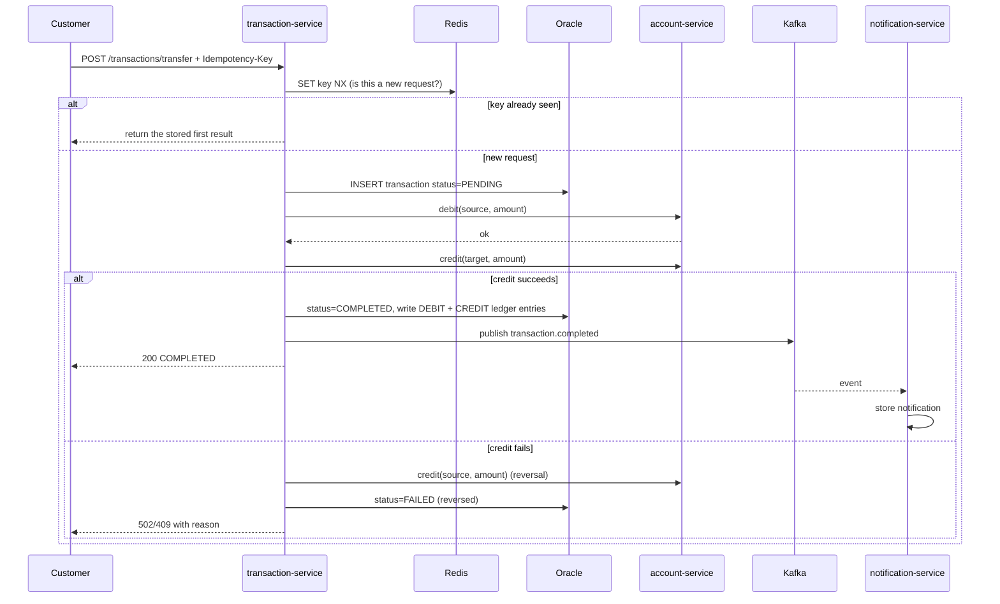

# CBS – Functional Specification

This document explains **what the system does and how it behaves**, before any code is written. Read it top to bottom once. Each time we build a feature, come back to its section.

Contents: [1 Purpose](#1-purpose-and-scope) · [2 Banking primer](#2-banking-primer-in-plain-words) · [3 Actors](#3-actors-and-roles) · [4 Use cases](#4-use-cases) · [5 Business rules](#5-business-rules) · [6 Flows](#6-flows-sequence-diagrams) · [7 Data model](#7-data-model) · [8 APIs](#8-api-list) · [9 Errors](#9-error-handling-standard) · [10 Non-functional](#10-non-functional-requirements) · [11 Resume mapping](#11-how-this-maps-to-the-resume) · [12 Oracle practice](#12-oracle-sql-and-plsql-practice-track)

---

## 1. Purpose and scope

**Purpose:** a small banking backend where a bank can register customers, open accounts for them, and move money, with secure access, fast reads and event-based notifications.

**In scope**

- Customer registration, profile, KYC status
- Savings and Current accounts, balance enquiry
- Deposit, withdrawal, transfer between accounts, transaction history
- Login via OAuth 2.0 / JWT, roles `CUSTOMER` and `ADMIN`
- Notification after every completed transaction
- Single currency (INR)

**Out of scope (deliberately)**

- Interest calculation, loans, cards, cheques, standing instructions
- End-of-day batch processing and general-ledger accounting
- Real KYC document verification (an admin simply sets the status)
- Multi-currency, multi-branch, regulatory reporting

Real core banking systems include all of the above. Knowing what we left out, and why, is itself a good interview answer.

---

## 2. Banking primer in plain words

| Term | Plain meaning | In our system |
|---|---|---|
| **Customer** | A person or company that the bank has a relationship with | Row in `customers` (customer-service) |
| **KYC (Know Your Customer)** | Checks the bank must do to confirm who the customer is before allowing banking | `kycStatus`: `PENDING`, `VERIFIED`, `REJECTED` |
| **Account** | A container of money belonging to a customer, with a unique account number | Row in `accounts` (account-service) |
| **Savings account** | For saving; usually a minimum balance, no overdraft | `SavingsAccount` |
| **Current account** | For business use; may allow an overdraft up to a limit | `CurrentAccount` |
| **Balance** | Money currently in the account | `accounts.balance` |
| **Deposit / Credit** | Money coming in; balance goes up | `DEPOSIT` |
| **Withdrawal / Debit** | Money going out; balance goes down | `WITHDRAWAL` |
| **Transfer** | A debit on one account and a matching credit on another | `TRANSFER` |
| **Ledger** | The permanent, append-only record of every money movement. Rows are never edited; mistakes are corrected by adding a reversing entry | `ledger_entries` |
| **Double entry** | Every movement has two sides: money leaves one place and arrives in another, so the books always balance | Transfer = one DEBIT + one CREDIT entry |
| **Idempotency** | Doing the same request twice has the same effect as doing it once | Duplicate "transfer 500" request must not move 1000 |
| **Reversal** | A new transaction that undoes an earlier one | Used when a transfer fails halfway |
| **Statement** | A list of an account's transactions over a period | Transaction history API |
| **Charges / fees** | Amounts the bank debits for services, e.g. a penalty for a low balance | Not built; related to the "charging engine" work on the resume |

### Why banking cares so much about correctness

Money systems follow **ACID**:

- **A**tomicity: a transfer either fully happens or not at all
- **C**onsistency: rules (no negative balance on a Savings account) always hold
- **I**solation: two simultaneous withdrawals can't both spend the same money
- **D**urability: once confirmed, it survives a crash

Inside one database, `@Transactional` gives us ACID. Across microservices (separate databases) we cannot have one database transaction, so we need careful design. That is the core challenge of this project, covered in section 6.4.

---

## 3. Actors and roles

| Actor | Role in Keycloak | Can do |
|---|---|---|
| Bank staff / admin | `ADMIN` | Create customers, set KYC status, open accounts for any customer, view any account or transaction |
| Customer | `CUSTOMER` | View own profile, own accounts, own transaction history; deposit, withdraw and transfer **from own accounts only** |
| System | (service-to-service) | account-service and transaction-service call each other; notification-service consumes events |

**Authentication** answers "who are you?" (Keycloak login, JWT). **Authorization** answers "what may you do?" (roles, plus ownership checks such as "this account belongs to you").

---

## 4. Use cases

| ID | Use case | Actor | Service |
|---|---|---|---|
| UC-01 | Register customer | ADMIN | customer |
| UC-02 | View / update customer profile | ADMIN, CUSTOMER (own) | customer |
| UC-03 | Update KYC status | ADMIN | customer |
| UC-04 | Open account | ADMIN | account (calls customer) |
| UC-05 | View account and balance | ADMIN, CUSTOMER (own) | account |
| UC-06 | Deposit | ADMIN, CUSTOMER (own) | transaction (calls account) |
| UC-07 | Withdraw | CUSTOMER (own), ADMIN | transaction (calls account) |
| UC-08 | Transfer | CUSTOMER (own source) | transaction (calls account) |
| UC-09 | View transaction history | ADMIN, CUSTOMER (own) | transaction |
| UC-10 | Receive notification | system | notification |

### UC-04 Open account (detailed example)

- **Precondition:** caller has role `ADMIN`; customer exists
- **Main flow:** (1) admin sends customer id, account type, opening deposit. (2) account-service calls customer-service. (3) customer-service confirms customer exists and KYC is `VERIFIED`. (4) account-service generates an account number, saves the account with status `ACTIVE`. (5) returns the account.
- **Alternative flows:** customer not found → `404`; KYC not verified → `409 Conflict` with message; opening deposit below the minimum → `400`; customer-service unreachable → `503` (we do not open the account blindly)
- **Postcondition:** one new row in `accounts`

Other use cases follow the same shape; we will write each out as we build it.

---

## 5. Business rules

These are **our simplified rules** (real banks configure many of these per product).

| ID | Rule |
|---|---|
| BR-01 | Customer email and phone must be unique. |
| BR-02 | New customers start with KYC status `PENDING`. |
| BR-03 | An account can be opened only for a customer whose KYC is `VERIFIED`. |
| BR-04 | Account numbers are 12 digits, generated by the system, unique. |
| BR-05 | Savings accounts require a minimum opening balance of 1,000.00 and may never go below 0. |
| BR-06 | Current accounts may go negative down to an overdraft limit of 10,000.00. |
| BR-07 | All amounts are positive, have at most 2 decimal places, and use `BigDecimal` (never `double`). |
| BR-08 | A withdrawal or transfer is rejected if it would break the balance rule of that account type. |
| BR-09 | A transfer needs two different accounts, both `ACTIVE`. |
| BR-10 | A frozen or closed account cannot be debited or credited. |
| BR-11 | Every money-moving request carries an `Idempotency-Key`. A repeated key returns the first result and moves no money again. |
| BR-12 | Every completed or failed transaction is recorded; records are never updated or deleted, only reversed by a new entry. |
| BR-13 | A `CUSTOMER` can touch only accounts that belong to them. |
| BR-14 | A completed transaction publishes exactly one `transaction.completed` event. |

---

## 6. Flows (sequence diagrams)

These use Mermaid, which GitHub renders automatically.

### 6.1 Login and calling an API

```mermaid
sequenceDiagram
    participant C as Client
    participant K as Keycloak
    participant G as API Gateway
    participant S as Service
    C->>K: login (username, password)
    K-->>C: signed JWT (access token)
    C->>G: GET /accounts/123 + Authorization: Bearer JWT
    G->>G: verify signature, expiry; check rate limit (Redis)
    G->>S: forward request with JWT
    S->>S: verify JWT again, check role and ownership
    S-->>G: 200 account JSON
    G-->>C: 200 account JSON
```

The JWT is **self-contained**: the service verifies the signature with Keycloak's public key and needs no session store. That is what "stateless" means.

### 6.2 Open account



### 6.3 Balance enquiry with Redis (cache-aside)



### 6.4 Transfer (the key flow)



**Why this is hard:** account-service and transaction-service have separate databases, so there is no single `COMMIT` covering both. If the debit succeeds and then the system crashes before the credit, money has vanished. Our approach is **orchestration with compensation**: the transaction-service drives the steps, records its progress as `PENDING`, and issues a reversal on failure. This is a basic form of the **Saga pattern**. A production system would add retries for the reversal and a recovery job that finds stale `PENDING` transactions. We will implement the basic version and be able to explain its limits.

---

## 7. Data model

### customer_db → `customers` (PostgreSQL)

| Column | Type | Notes |
|---|---|---|
| id | BIGINT PK | generated |
| name | VARCHAR(100) | required |
| email | VARCHAR(150) | unique |
| phone | VARCHAR(15) | unique |
| address | VARCHAR(255) | |
| kyc_status | VARCHAR(10) | `PENDING` / `VERIFIED` / `REJECTED` |
| auth_user_id | VARCHAR(64) | the `sub` claim from the Keycloak JWT, links login to customer |
| created_at | TIMESTAMP | |

### account_db → `accounts` (PostgreSQL)

| Column | Type | Notes |
|---|---|---|
| id | BIGINT PK | generated |
| account_number | VARCHAR(12) | unique |
| customer_id | BIGINT | **plain number, not a foreign key**: the customer lives in another service's database |
| account_type | VARCHAR(10) | `SAVINGS` / `CURRENT` |
| balance | NUMERIC(15,2) | |
| status | VARCHAR(10) | `ACTIVE` / `FROZEN` / `CLOSED` |
| version | BIGINT | optimistic locking, prevents lost updates |
| created_at | TIMESTAMP | |

### txn schema → `transactions`, `ledger_entries` (Oracle)

`transactions`

| Column | Type | Notes |
|---|---|---|
| id | NUMBER PK | sequence or identity |
| idempotency_key | VARCHAR2(64) | **unique constraint**, a second safety net behind Redis |
| type | VARCHAR2(12) | `DEPOSIT` / `WITHDRAWAL` / `TRANSFER` |
| source_account | VARCHAR2(12) | null for deposits |
| target_account | VARCHAR2(12) | null for withdrawals |
| amount | NUMBER(15,2) | |
| status | VARCHAR2(10) | `PENDING` / `COMPLETED` / `FAILED` / `REVERSED` |
| failure_reason | VARCHAR2(255) | |
| created_at | TIMESTAMP | |

`ledger_entries`

| Column | Type | Notes |
|---|---|---|
| id | NUMBER PK | |
| transaction_id | NUMBER FK → transactions.id | |
| account_number | VARCHAR2(12) | |
| entry_type | VARCHAR2(6) | `DEBIT` / `CREDIT` |
| amount | NUMBER(15,2) | |
| created_at | TIMESTAMP | |

### notifications (MongoDB document)

```json
{
  "transactionId": 981,
  "accountNumber": "100000000123",
  "message": "INR 500.00 debited from your account",
  "createdAt": "2026-10-25T14:05:00Z"
}
```

### Kafka event `transaction.completed` (JSON)

```json
{
  "transactionId": 981,
  "type": "TRANSFER",
  "sourceAccount": "100000000123",
  "targetAccount": "100000000456",
  "amount": 500.00,
  "status": "COMPLETED",
  "timestamp": "2026-10-25T14:05:00Z"
}
```

### Redis keys

| Key pattern | Used by | Purpose | Lifetime |
|---|---|---|---|
| `account:{id}` | account-service | cached balance / details | short TTL, evicted on change |
| `idem:{Idempotency-Key}` | transaction-service | duplicate-request guard and stored result | e.g. 24 hours |
| rate-limit keys (managed by Spring Cloud Gateway) | gateway | request counting per client | seconds |

---

## 8. API list

All calls go through the gateway at `http://localhost:8080`. Paths are a starting design and may be refined while building.

**customer-service**

| Method | Path | Role | Purpose |
|---|---|---|---|
| POST | /customers | ADMIN | register customer |
| GET | /customers/{id} | ADMIN, CUSTOMER (own) | get customer |
| GET | /customers | ADMIN | list customers |
| PUT | /customers/{id} | ADMIN, CUSTOMER (own) | update profile |
| PATCH | /customers/{id}/kyc | ADMIN | set KYC status |

**account-service**

| Method | Path | Role | Purpose |
|---|---|---|---|
| POST | /accounts | ADMIN | open account |
| GET | /accounts/{accountNumber} | ADMIN, CUSTOMER (own) | account details |
| GET | /accounts/{accountNumber}/balance | ADMIN, CUSTOMER (own) | balance (cached) |
| GET | /accounts?customerId= | ADMIN, CUSTOMER (own) | accounts of a customer |
| POST | /accounts/{accountNumber}/debit | internal | used by transaction-service |
| POST | /accounts/{accountNumber}/credit | internal | used by transaction-service |

**transaction-service**

| Method | Path | Role | Purpose |
|---|---|---|---|
| POST | /transactions/deposit | CUSTOMER, ADMIN | deposit (needs `Idempotency-Key`) |
| POST | /transactions/withdraw | CUSTOMER, ADMIN | withdraw (needs `Idempotency-Key`) |
| POST | /transactions/transfer | CUSTOMER | transfer (needs `Idempotency-Key`) |
| GET | /transactions?accountNumber= | ADMIN, CUSTOMER (own) | history / statement |

The `/debit` and `/credit` endpoints are internal: the gateway will not route them to outside callers, and they will accept only a service-level token. We will implement this in the security phase.

---

## 9. Error handling standard

Every service returns errors in one shape, produced by a single `@RestControllerAdvice`:

```json
{
  "timestamp": "2026-10-25T14:05:00Z",
  "status": 409,
  "error": "Conflict",
  "message": "Customer KYC is not verified",
  "path": "/accounts"
}
```

| Situation | HTTP status |
|---|---|
| Validation failed (blank name, negative amount) | 400 |
| Not logged in / invalid or expired token | 401 |
| Logged in but not allowed (wrong role or not your account) | 403 |
| Resource not found | 404 |
| Business rule violated (insufficient funds, KYC not verified, duplicate email) | 409 (or 422) |
| Rate limit exceeded | 429 |
| Downstream service failure | 502 / 503 |
| Unexpected error | 500 (details logged, not exposed) |

---

## 10. Non-functional requirements

- **Security:** stateless JWT; passwords never stored by our services (Keycloak owns them); secrets from environment variables; no sensitive data in logs.
- **Performance:** balance reads served from Redis when possible; goal is to be able to explain the cache hit and miss behavior and measure it.
- **Reliability:** timeouts on every service-to-service call; compensation for failed transfers; idempotent money operations.
- **Observability:** structured logging, a correlation id passed between services, Actuator health endpoints.
- **Testability:** service-layer unit tests with Mockito; repository tests; at least one end-to-end run through the gateway.
- **Portability:** `docker compose up` starts all infrastructure and services.

---

## 11. How this maps to the resume

| Resume statement | Where it is built |
|---|---|
| Modular microservices architecture with an API Gateway for centralized routing and service communication | Three business services plus notification, Spring Cloud Gateway, REST calls between services, Kafka events |
| Secured REST APIs with Spring Security, OAuth 2.0 and JWT for stateless authentication and authorization | Keycloak, resource-server configuration in gateway and services, roles, ownership checks |
| Integrated Redis caching to improve performance | Cache-aside on account balance, plus idempotency keys and rate limiting |

For each row, I should be able to answer: what was the problem, what did I choose, what were the alternatives, and what are the limits of my solution.

---

## 12. Oracle SQL and PL/SQL practice track

The transaction-service uses Oracle, so we also practice the SQL that banking interviews ask about:

1. Create `transactions` and `ledger_entries` with constraints and indexes
2. Joins: list each transaction with both account numbers and statuses
3. `GROUP BY` / `HAVING`: total debits per account per day; accounts with more than N transactions
4. Window functions: running balance per account with `SUM(...) OVER (PARTITION BY account_number ORDER BY created_at)`
5. Find duplicate idempotency keys; find `PENDING` transactions older than 10 minutes
6. A PL/SQL procedure that posts a transfer atomically inside Oracle, compared with doing it from Java
7. Explain plans and when an index helps

These tie directly to the batch, ledger and transaction-history work on the resume.
